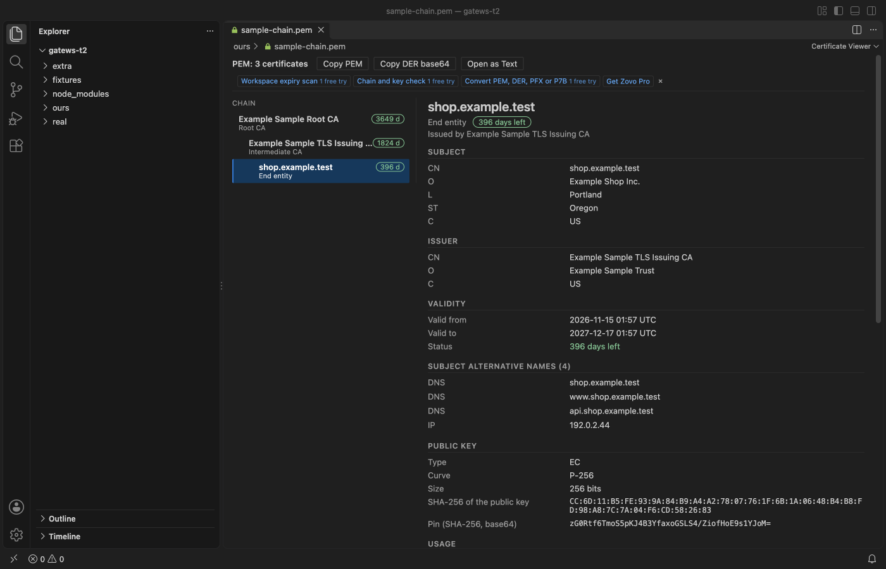

# Certificate Viewer, X509 & PEM

Open certificates, keys and bundles in a VS Code tab: click a .pem, .crt, .cer, .der, .p7b, .pfx, .p12, .csr or .key file and read who it is for, who issued it and how many days it has left. Works offline. Made by Zovo.

Free, with no account and no network calls:

- A readable card for each certificate: subject, issuer, valid from and to with days left, alternative names (DNS, IP, email, URI), key type and size, key usage, extended key usage, SHA-1 and SHA-256 fingerprints, serial number and every extension.
- PEM files with several certificates show the chain as a tree: root, then intermediate, then leaf, with each signature checked.
- DER (.cer, .der), PKCS#7 bundles (.p7b, .p7c), PKCS#12 files (.pfx, .p12), certificate requests (.csr) and private keys (.key: PKCS#8, PKCS#1, SEC1, encrypted PKCS#8).
- PFX and P12 files ask for the password once, in the page. It stays in memory for the session only and is never saved.
- Private keys show their type, size and public key fingerprint, and which certificate they belong to. The private key numbers are never shown.
- Hover over a PEM block in any file (YAML, JSON, .env, Terraform, code) to see its name, issuer and expiry. Base64 PEM in Kubernetes secrets works too.
- Copy a certificate as PEM or as one-line DER base64.

Zovo Pro: USD 19 once, for the Pro tools in every Zovo extension. Each Pro tool has 1 free try on your computer first:

- Workspace expiry scan: every certificate in the workspace, also PEM blocks inside YAML, JSON, .env files and Kubernetes secrets, sorted by days to expiry, saved as a CSV or Markdown report.
- Chain and key check: chain order and signatures, a missing intermediate, CA flags and path lengths, and whether a certificate, a private key and a CSR belong together. Optional host name check.
- Convert PEM, DER, PFX or P7B: any direction, split a bundle into one file per certificate, or merge files into one bundle in chain order. New PFX files use AES-256.

## How to use it

- Click a certificate file in the Explorer. If another editor opens it, right-click the file and choose Open in Certificate Viewer.
- In a bundle, click a certificate in the chain list, or use the up and down arrow keys.
- Open as Text shows the file in the text editor. Show this block in the text selects the certificate's PEM block there.
- In YAML, JSON or .env files, rest the pointer on a certificate. The hover link Open in Certificate Viewer shows every certificate of that file.
- To try it, run Certificate Viewer: Open the Sample Certificate Chain from the Command Palette. Certificate Viewer: Open the Sample Kubernetes Secret shows the hover. The sample certificates were made for this purpose and include no private key.
- The Pro tools are in the Command Palette (Certificate Viewer: ... (Pro)), in the Explorer right-click menu and in the small row at the end of the viewer toolbar. The row closes with its x for the rest of the session, and the setting `certViewer.showProTools` hides it for good.

## What it reads

| File | What shows |
|---|---|
| .pem, .crt, .cer (PEM or DER) | Certificates, requests, keys and public keys, any number per file |
| .der | One certificate, request or key in binary form |
| .p7b, .p7c | Every certificate of the PKCS#7 bundle |
| .pfx, .p12 | Certificates and the private key, after the password (AES and PBKDF2, or the older 3DES and RC2 schemes) |
| .csr | Subject, requested names and extensions, key, signature check |
| .key | Key type, size, public key fingerprint; encrypted PKCS#8 keys after the password |

Revocation lists (CRL) and OpenSSH keys are named but not shown in this version. Keys with the old PEM encryption (Proc-Type headers) show the cipher only.

## Privacy

The extension reads the file you open and nothing else. It makes no network calls, and nothing is uploaded or measured. Certificate addresses (CRL and issuer links) are shown, never fetched. Passwords stay in memory for the session and are never written anywhere. The Pro tools write only the files you ask for. The links at the bottom of the viewer (Rate, More free tools, Zovo Pro) open a page only when you click them, and the setting `certViewer.showSupportLinks` hides them.

## Settings

| Setting | Default | What it does |
|---|---|---|
| `certViewer.hover` | true | Shows the hover on PEM blocks in any file. |
| `certViewer.maxFileSizeMB` | 50 | Larger files open with a message instead of the card. |
| `certViewer.showProTools` | true | Shows the Pro tools in menus, the palette and the toolbar row. |
| `certViewer.showSupportLinks` | true | Shows the Rate, More free tools and Zovo Pro links. |
| `certViewer.askForRating` | true | Asks once for a rating after two good uses at least 30 minutes apart. |

## Zovo Pro

One payment of USD 19 unlocks the Pro tools in every Zovo extension on your computers; a team of 5 is USD 59. The key works offline. Run Zovo Pro: Get Zovo Pro from the Command Palette, or click Get Zovo Pro in the toolbar row. The Zovo Pro tab lists this extension's Pro tools and whether your free try is left before any payment page opens.

Certificate Viewer, X509 & PEM is made by Zovo.
